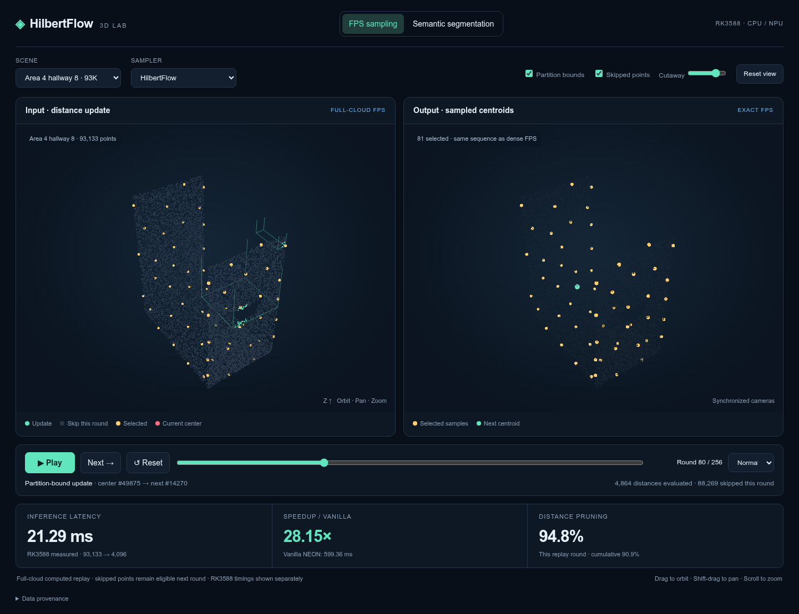
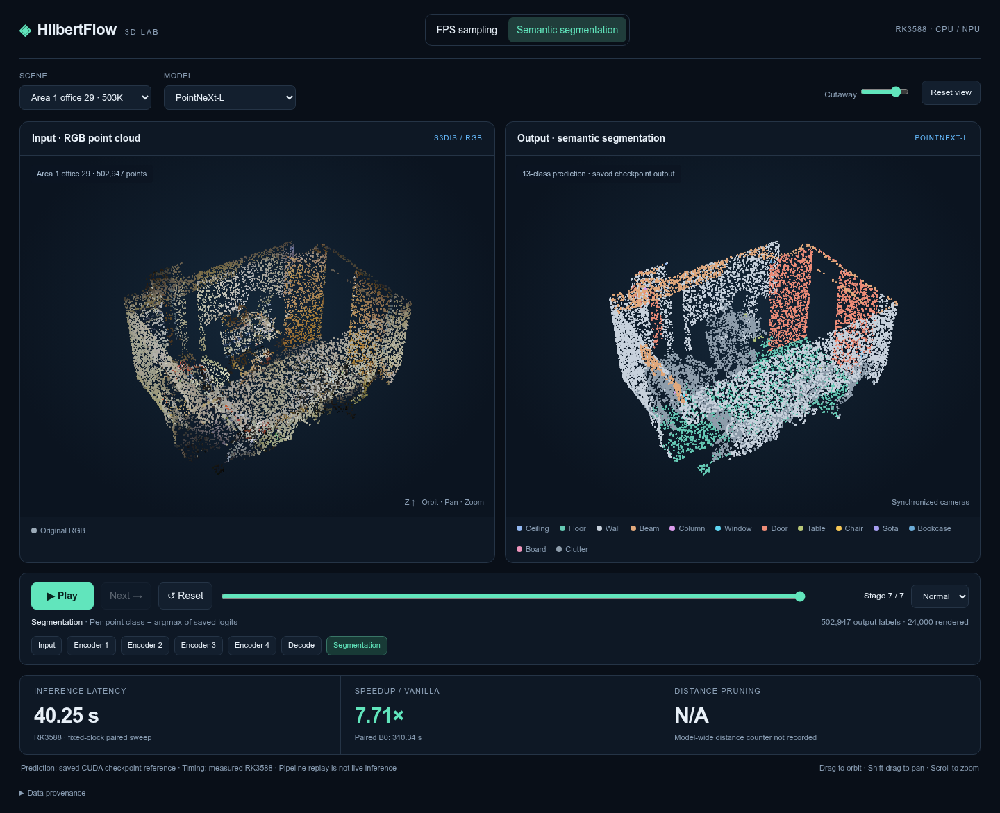

# RKNN HilbertFlow

Interactive 3D demonstrations of partition-aware FPS and point-cloud semantic
segmentation, with measured RK3588 performance metrics.

## Project status

**This repository currently serves as a demonstration of HilbertFlow.** It
provides an interactive visualization of FPS sampling and semantic segmentation,
along with recorded performance results. The complete research implementation,
including the RK3588 optimization kernels and model integration code, will be
open-sourced after the paper is accepted.

## Demo preview

### FPS sampling

Replay individual FPS iterations in synchronized 3D views. Highlighted partitions
show which points require distance updates and which can be skipped in the current
round. The right view displays the selected centroids.

### Semantic segmentation

Compare the RGB input with saved per-point semantic predictions. The demo also
shows the encoder sampling hierarchy and recorded RK3588 inference metrics.

These screenshots preview the interface directly on GitHub. Download the demo
below to rotate the point clouds and play or scrub through the processing stages.

## Run the demo

1. [Download the demo ZIP](downloads/HilbertFlow_RK3588_Demo.zip).
2. Extract it and open `index.html` in Chrome, Edge or Firefox.

Alternatively, download the root [`index.html`](index.html) directly. The page is
self-contained and works offline with WebGL enabled. No server is required.
GitHub's file viewer displays the HTML source; download it to run the demo.

## Controls

- Switch between **FPS sampling** and **Semantic segmentation**.
- Drag either point-cloud view to orbit both cameras; Shift-drag to pan and scroll to zoom.
- Use **Play**, **Next**, or the timeline to inspect sampling rounds or model stages.
- Toggle partition bounds and skipped points, or use the cutaway to reveal room interiors.

## Data and measurement scope

The demo uses real S3DIS scenes with 93,133, 201,841 and 502,947 input points.
Each FPS replay contains 256 full-cloud distance-update rounds. All rounds are
checked against a dense FPS oracle. Green points undergo distance evaluation;
grey points belong to partitions skipped for the current update and remain
eligible in later rounds. Replay uses a float64 reference of the Hilbert/AABB
algorithm. RK3588 latency measurements come from separate recorded N-to-4096
FPS experiments.

The segmentation view uses saved checkpoint predictions from PointNeXt-L
(three scenes) and PointVector-XL (93K scene). Encoder views use saved sampling
indices; output classes are obtained from saved logits. Predictions are CUDA
checkpoint references; the displayed RK3588 timings are separately measured
end-to-end results. The offline demo does not invoke live inference.

## Contents

- `index.html`: standalone English 3D demo with embedded data.
- `downloads/`: portable ZIP, including metric CSVs and documentation.
- `demo-source/`: HTML template, data builder and replay audit.

The source builder expects the original VD4FPS workspace and source artifacts.
See [source documentation](demo-source/README.md) for the rebuild requirements.
